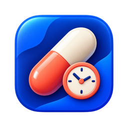

<p align="center">
  
</p>

<h1 align="center">MediCheck</h1>

<p align="center">
  <strong>轻量、纯本地的 macOS 原生菜单栏用药提醒与打卡工具</strong><br/>
  A native macOS 14+ menu-bar medication reminder & adherence tracker built with SwiftUI.
</p>

<p align="center">
  
  
  
</p>

---

## 核心特性 (Features)

- **多类型用药计划**：
  - **固定疗程 (Fixed Course)**：支持自定义起止日期（如 10 天 / 14 天阶段性处方疗程）与每日多时间点提醒。
  - **长期维保 (Ongoing Plan)**：支持每日或按星期几重复的长期规律服药计划。
  - **按需记录 (As-Needed / PRN)**：支持不定时按需服药的快速打卡归档。
- **防漏服与防误触闭环**：
  - 到点弹窗与系统原生通知提醒、未确认自动重复提醒（可配置间隔）。
  - Mac 睡眠唤醒与跨日对账，晚间汇总巡检当日未完成项。
  - 每次确认「已服用」或「跳过」前提供防误触二次确认。
- **可视化日历与统计**：
  - 月历视图直观展示每日完成进度，支持按天回溯每顿药的计划时间与实际确认时间。
  - 最近 7 天完成率统计与 `v1` 历史数据无损自动迁移。
- **零联网隐私优先**：
  - 无账号、不联网、无遥测，全部数据仅保存在本机沙盒。
  - 支持通过 `SMAppService` 配置开机自动启动，常驻右上角菜单栏。

---

## 安装与构建 (Installation & Build)

### 方式一：直接下载预编译包
前往 [Releases](https://github.com/amiduai/MediCheck/releases) 下载最新版本的 `MediCheck-v2.0.0-app.zip`（Universal 通用二进制，同时支持 Apple Silicon `arm64` 与 Intel `x86_64`），解压后拖入 `/Applications` 即可。

> 若首次打开提示未公证开发者，可在终端执行 `xattr -cr /Applications/MediCheck.app` 后打开，或在「系统设置 → 隐私与安全性」中点击「仍要打开」。

### 方式二：从源码编译
本项目使用 [XcodeGen](https://github.com/yonaskolb/XcodeGen) 管理工程配置（仓库已附带生成的 `MediCheck.xcodeproj`）：

```bash
# 1. 可选：根据 project.yml 重新生成 Xcode 工程
xcodegen generate --spec project.yml --project .

# 2. 运行单元测试
xcodebuild -project MediCheck.xcodeproj -scheme MediCheck test

# 3. 编译 Release 版本
xcodebuild -project MediCheck.xcodeproj -scheme MediCheck -configuration Release build
```

也可以直接用 Xcode 打开 `MediCheck.xcodeproj`，选择 `MediCheck` scheme 和 `My Mac` 运行。

---

## 项目结构 (Architecture)

```text
MediCheck/
├── MediCheck/
│   ├── MediCheckApp.swift               # MenuBarExtra 入口与生命周期挂载
│   ├── Models/
│   │   ├── Medication.swift             # 药品、固定疗程/长期/按需计划模型
│   │   ├── DoseRecord.swift             # 每日服药打卡记录与迁移兼容模型
│   │   ├── DoseType.swift               # 时段与状态枚举
│   │   └── MedicationSettings.swift     # 提醒间隔、晚间巡检与开机自启配置
│   ├── Services/
│   │   ├── ReminderService.swift        # 定时调度、唤醒对账与状态机核心
│   │   ├── StorageService.swift         # 本地 UserDefaults 持久化与 v1->v2 迁移
│   │   ├── NotificationService.swift    # UNUserNotificationCenter 本地通知
│   │   ├── ReminderWindowController.swift # 独立悬浮提醒窗口控制
│   │   ├── LoginItemService.swift       # SMAppService 登录项管理
│   │   └── DateSupport.swift            # 日历网格、跨日计算与时间格式化
│   └── Views/
│       ├── MenuBarView.swift            # 菜单栏主面板（今日待办、按需记录、入口导航）
│       ├── MedicationPlansView.swift    # 药品与计划增删改查界面
│       ├── HistoryView.swift            # 月历打卡历史与明细回溯视图
│       ├── ReminderView.swift           # 到点弹窗提醒视图
│       ├── SettingsView.swift           # 偏好设置面板
│       └── SharedViews.swift            # 通用 UI 组件
└── MediCheckTests/
    └── DateSupportTests.swift           # 日期计算、跨日与 v2 计划调度单元测试
```

---

## 本地数据与隐私边界 (Privacy & Disclaimer)

- **本地存储路径**：默认 Bundle ID 为 `com.local.MediCheck`，沙盒数据位于：
  `~/Library/Containers/com.local.MediCheck/Data/Library/Preferences/com.local.MediCheck.plist`（用药记录最多保留 730 天）。
- **医疗免责声明**：MediCheck 仅执行用户自行录入的提醒与打卡记录，**不提供任何医疗诊断、剂量推荐、药物相互作用检查或漏服补服建议**。具体用药方案请务必遵循临床医生或执业药师指导。
- **隐私提醒**：请勿在公开 Issue、PR 或截图中上传包含真实姓名、病历号或处方单的敏感信息。

---

## 开源协议 (License)

本项目基于 [MIT License](LICENSE) 开源。
